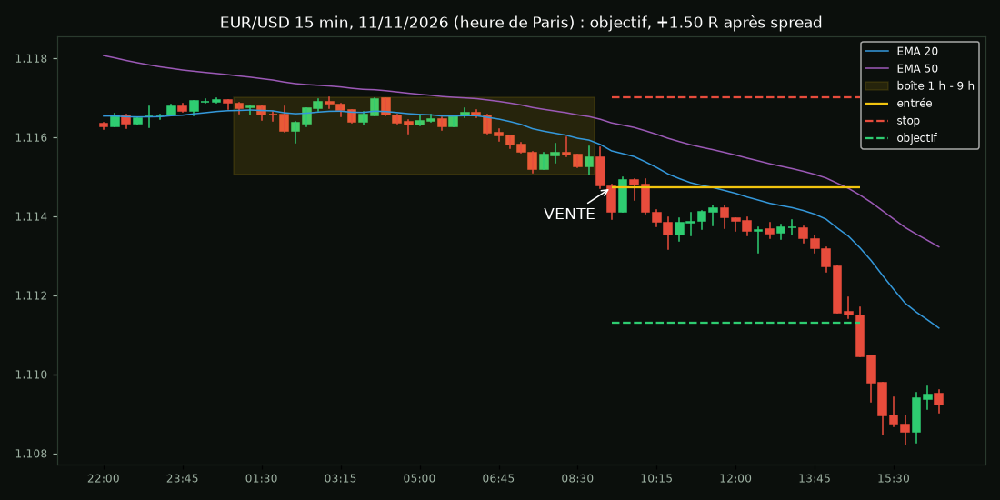
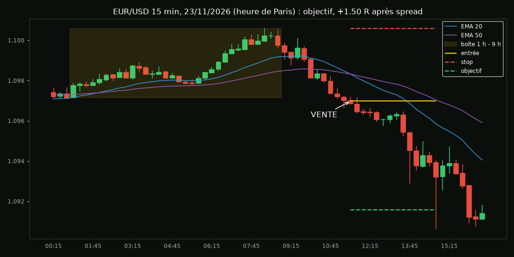
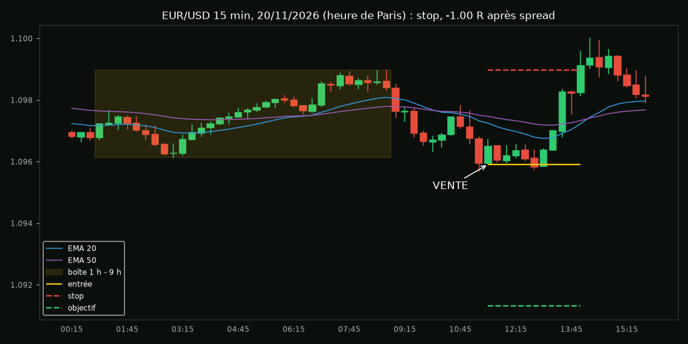
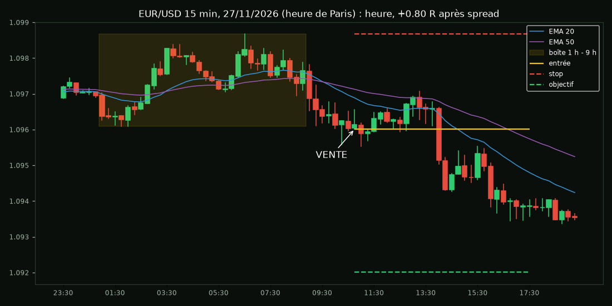

# Fiche : la Cassure de Londres sur l'EUR/USD (trading manuel, compte DÉMO)

> Une stratégie rapide, avec des règles fixes, faisable à la main en 15 minutes par jour.
> 1 trade par jour maximum, ouvert le matin, fermé au plus tard à 17 h 30. Jamais de position la nuit.
> Toutes les heures sont en **heure de Paris**.

---

## 1. L'idée en une phrase

Pendant la nuit (de 1 h à 9 h), l'EUR/USD bouge peu et dessine une **boîte**. À l'ouverture de Londres (9 h), les gros volumes arrivent. Quand le prix **sort franchement de la boîte**, on suit ce mouvement, avec un stop de l'autre côté de la boîte.

---

## 2. Ce qu'il te faut

- Le **compte démo Capital.com**. Idéalement un **2e compte démo** (une autre adresse e-mail suffit), séparé de celui du bot. Sinon tes trades manuels fausseraient les chiffres et les garde-fous du bot (pause à -15 % dans la journée, etc.).
- Le graphique **EUR/USD en bougies de 15 minutes**.
- Le **journal de trades** (fichier `journal-de-trades.csv`, s'ouvre dans Excel ou Google Sheets).

---

## 3. Les règles (à suivre à la lettre)

### Étape 1 : tracer la boîte (à 9 h 00)
1. Regarde les bougies 15 min **de 1 h 00 à 9 h 00**.
2. Note le **plus haut** de toutes ces bougies (le haut de la mèche la plus haute) : c'est le **HAUT de la boîte**.
3. Note le **plus bas** (le bas de la mèche la plus basse) : c'est le **BAS de la boîte**.
4. Trace 2 lignes horizontales sur le graphique (outil « ligne horizontale »).
5. Calcule la hauteur : HAUT - BAS, en pips (1 pip = 0,0001. Exemple : 1,0985 - 1,0962 = 23 pips).
   - **Boîte de plus de 40 pips : pas de trade aujourd'hui.** (Trop de risque, le marché a déjà trop bougé.)
   - Boîte de moins de 3 pips : pas de trade non plus.

### Étape 2 : attendre la sortie (de 9 h 00 à 13 h 00)
- On regarde seulement **la CLÔTURE** des bougies 15 min (pas les mèches).
- **Une bougie clôture AU-DESSUS du HAUT** de la boîte : on **ACHÈTE** tout de suite (au début de la bougie suivante).
- **Une bougie clôture EN DESSOUS du BAS** de la boîte : on **VEND** tout de suite.
- Seulement **la première sortie de la journée**. Une fois le trade pris (gagné ou perdu), **c'est fini pour aujourd'hui**.
- Pas de sortie avant 13 h 00 : **pas de trade aujourd'hui**. On n'entre jamais après 13 h.

### Étape 3 : placer le stop et l'objectif (en même temps que l'ordre)
- **Stop** : de l'autre côté de la boîte.
  - Achat : stop au **BAS** de la boîte.
  - Vente : stop au **HAUT** de la boîte.
- **Objectif** : à **1,5 fois** la distance entre ton prix d'entrée et ton stop.
  - Exemple achat : entrée 1,0990, stop 1,0962 → distance 28 pips → objectif = 1,0990 + 42 pips = **1,1032**.
- Les deux se règlent dans la fenêtre d'ordre Capital.com (« Stop loss » et « Take profit »).

### Étape 4 : la taille de position (1 % de risque, jamais plus)
- Risque = **1 % du compte**. Sur 100 € : **1 €** maximum perdu si le stop est touché.
- Taille approximative : **taille ≈ risque en € × 10 000 ÷ stop en pips**.
  - Exemple : 1 € de risque, stop 28 pips → 1 × 10 000 ÷ 28 ≈ **350 unités** d'EUR/USD.
- **Vérification obligatoire** : dans la fenêtre d'ordre, Capital.com affiche la perte en € si le stop est touché. Ajuste la taille jusqu'à lire **environ 1 €**.

### Étape 5 : ne plus toucher (jusqu'à 17 h 30)
- On **ne déplace pas** le stop. On **ne coupe pas** avant. On **ne rajoute pas** de position.
- Si ni le stop ni l'objectif ne sont touchés, **on ferme à la main à 17 h 30**, quel que soit le résultat.
- Le test montre que plus de la moitié des trades finissent ainsi, à 17 h 30. C'est normal.

---

## 4. Checklist du jour (à cocher)

| # | Question | Oui / Non |
|---|---|---|
| 1 | C'est un jour de semaine (lundi à vendredi) ? | |
| 2 | Boîte 1 h - 9 h tracée (HAUT et BAS notés) ? | |
| 3 | Hauteur de la boîte entre 3 et 40 pips ? | |
| 4 | Une bougie 15 min a **clôturé** hors de la boîte, avant 13 h ? | |
| 5 | C'est la **première** sortie de la journée ? | |
| 6 | Stop de l'autre côté de la boîte, objectif à 1,5 fois la distance ? | |
| 7 | Perte affichée au stop ≈ 1 % du compte ? | |
| 8 | Alarme mise à 17 h 30 pour fermer ? | |
| 9 | Trade noté dans le journal ? | |

Un seul « Non » de 1 à 7 : **pas de trade**.

---

## 5. Exemples réels (tirés du test, EUR/USD 15 min)

La zone jaune = la boîte 1 h - 9 h. Ligne jaune = entrée, rouge pointillée = stop, verte pointillée = objectif. (Les lignes bleue et violette sont des moyennes affichées pour info : la stratégie ne s'en sert pas.)

- **11/11/2026, vente gagnante (+1,5 R)** : clôture sous la boîte à 9 h 15, le prix descend jusqu'à l'objectif. 
- **Autre trade gagnant (objectif touché)** : 
- **20/11/2026, vente perdante (-1 R)** : sortie par le bas à 11 h 30, puis le prix remonte jusqu'au stop. **C'est normal, ça arrive environ 1 fois sur 3.** 
- **Trade fermé à 17 h 30** (ni stop ni objectif) : 

Les 15 derniers trades du test (fin octobre à fin novembre 2026) : 7 gagnants, 8 perdants, **+0,1 R au total** (quasi à zéro sur un mois). Ça montre bien le rythme réel : beaucoup de petits résultats, quelques gros gains et quelques stops.

---

## 6. Ce que la stratégie a VRAIMENT donné en test (franchement)

Test sur les vraies bougies Capital.com, avec le **vrai spread payé** sur chaque trade (environ 0,6 à 0,7 pip), sur presque 2 ans (fin décembre 2024 à fin novembre 2026), avec nos règles anti-triche (entrée seulement après la clôture de la bougie, stop compté en premier en cas de doute, réglages choisis sur la 1re période puis jugés sur une période jamais vue, contrôle sur prix mélangés).

**On a testé 4 stratégies rapides sur l'EUR/USD :**

| Stratégie | Résultat sur la période jamais vue |
|---|---|
| **Cassure de Londres (boîte 1 h - 9 h)** | **Seule à rester positive, en 15 min ET en 5 min** |
| Cassure de New York (boîte 14 h 30 - 15 h) | Perdante |
| Repli sur la moyenne mobile (EMA 20) | Perdante en 15 min, instable en 5 min |
| Rebond sur les bandes de Bollinger | Perdante partout (le spread la mange) |

**Les chiffres de la Cassure de Londres (règles de cette fiche), 15 min :**

| Période | Trades | Gagnants | Gain moyen par trade | Total |
|---|---|---|---|---|
| déc. 2024 - mai 2025 | 47 | 43 % | +0,03 R | +1,5 R |
| juin - nov. 2025 | 83 | 47 % | +0,04 R | +3,3 R |
| déc. 2025 - mai 2026 | 80 | 50 % | -0,07 R | -5,2 R |
| juin - nov. 2026 | 98 | 54 % | +0,06 R | +6,0 R |
| **Tout (23 mois)** | **308** | **49 %** | **+0,02 R** | **+5,6 R** |

(1 R = la somme risquée. Avec 1 % de risque sur 100 €, 1 R = 1 €.)

**Ce que ça veut dire, sans enrober :**
- 3 semestres sur 4 sont positifs. Sur 23 mois, la stratégie gagne **un peu** : **+5,6 R**, soit environ **+5,60 € sur un compte de 100 €** avec 1 % de risque. C'est presque à l'équilibre.
- La pire baisse a été de **-15,9 R** (environ -16 % du compte avec 1 % de risque), et jusqu'à **9 trades perdants d'affilée**. Il faut s'y attendre.
- Sur des prix mélangés (sans vraie structure de marché), elle perd un peu (-0,01 à -0,08 R par trade) : la petite avance vient donc bien du vrai marché, mais elle est **petite**.
- Environ **13 trades par mois** (un jour sur deux, les autres jours la boîte est trop grande ou rien ne sort).

**Pourquoi c'est quand même la bonne stratégie pour apprendre :**
1. Règles 100 % claires : pas d'interprétation, tu peux vérifier toi-même si tu as bien fait.
2. Peu de temps : 9 h pour la boîte, une alerte de prix, 17 h 30 pour fermer.
3. Tu apprends les vrais réflexes : stop obligatoire, taille à 1 %, ne pas toucher au trade, tenir un journal.
4. La gestion du risque compte plus que la stratégie : avec ces règles, une mauvaise série coûte ~10-16 %, pas tout le compte.

---

## 7. Le plan d'entraînement

- **Semaine 1 (à partir du lundi 30/11)** : appliquer les règles **sans exception**, tout noter dans le journal, même les jours sans trade.
- **Après 20 trades** (~6 semaines) : on compare ton journal avec ce que la stratégie aurait fait automatiquement. Le but n'est pas de gagner tout de suite, c'est de **suivre les règles à 100 %**.
- **Après 50 trades** : premier vrai bilan sur tes chiffres à toi.
- Toujours en **démo**. Le passage au réel, ce n'est pas maintenant.

**Astuce Capital.com** : mets une **alerte de prix** sur le HAUT et le BAS de la boîte à 9 h. Tu n'as pas besoin de rester devant l'écran : quand l'alerte sonne, tu attends la clôture de la bougie 15 min et tu vérifies qu'elle est bien hors de la boîte.

---

## 8. Les erreurs à éviter

- Entrer sur une **mèche** qui dépasse la boîte sans que la bougie **clôture** dehors.
- Reprendre un 2e trade le même jour après un stop (« me refaire ») : **interdit**.
- Déplacer le stop parce que « ça va remonter ».
- Augmenter la taille après des pertes.
- Garder la position après 17 h 30 (frais de nuit et nouvelle journée).
- Trader les jours de grosses annonces US à 14 h 30 (emploi américain le 1er vendredi du mois, inflation CPI, Fed) **si le trade est encore ouvert** : pas interdit par les règles testées, mais note-le dans le journal pour voir l'effet.

---

*Fiche créée le 28/11/2026. Code du test : `backtest/manuel_eurusd.py`, résultats complets : `backtest/MANUEL_EURUSD.md` dans le dépôt.*
